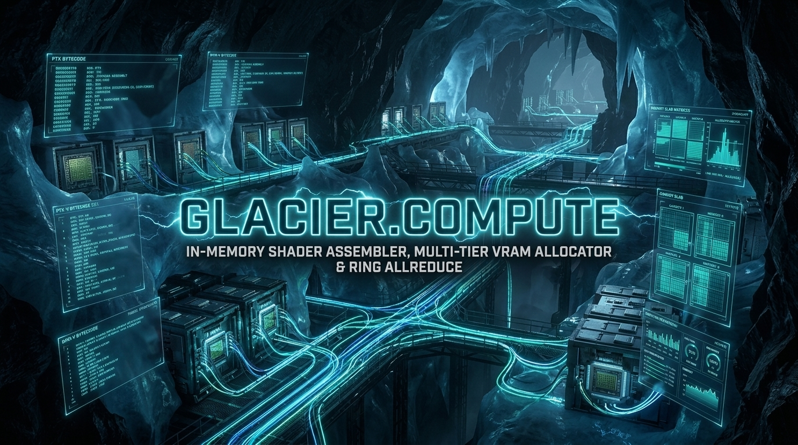
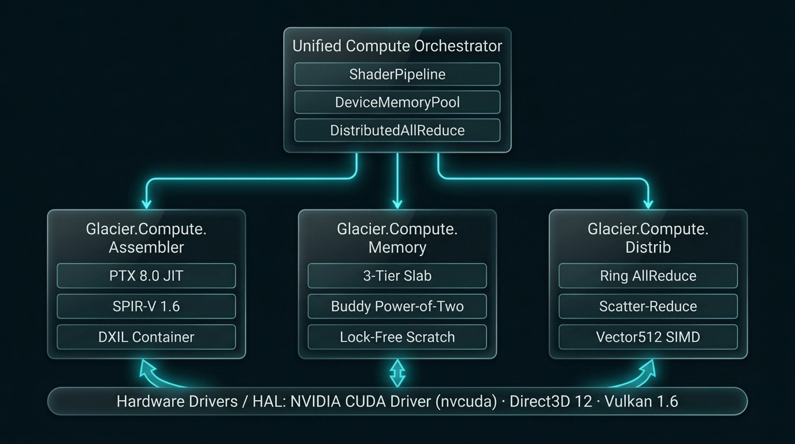

# ⚡ Glacier.Compute

[](LICENSE)
[](https://dotnet.microsoft.com/)
[]()
[]()
[]()
[](https://glaciersoftware.dev/)
[](https://buymeacoffee.com/glaciersoftware)

> **Pillar 13 of the Glacier High-Performance Ecosystem (`v1.1.0`)**  
> Pure C# .NET 10 In-Memory Shader Bytecode Assembler (PTX 8.0, SPIR-V 1.6, Precompiled DXBC Container Packager), Backing-Agnostic Multi-Tier Device & Host Arena Sub-Allocator, and Distributed Ring AllReduce with SIMD Vectorization.

---

## 1. Executive Summary & Strategic Mandate

Modern GPU acceleration and distributed machine learning in .NET are traditionally hampered by external native toolchains and runtime bottlenecks:
1. **External Compiler Sub-Processes (`glslc`, `nvcc`)**: Generating PTX or Vulkan SPIR-V compute pipelines via CLI processes adds 50–300 ms of process-launch overhead per dynamic kernel.
2. **Driver Allocation Contention**: Calling GPU driver allocators (`cuMemAlloc`, `CreateCommittedResource`) on every tensor allocation takes 5–25 μs and serializes threads through global driver locks.
3. **Proprietary Collective Dependencies**: Distributed gradient synchronization traditionally requires platform-locked native binaries (`nccl`).

**Glacier.Compute** provides a 100% pure C# .NET 10 Native AOT-compatible compute foundation:
- **In-Memory PTX 8.0 & SPIR-V 1.6 Assembler**: Programmatic microsecond emission of NVIDIA PTX 8.0 assembly and spec-compliant SPIR-V 1.6 compute modules (`StorageBuffer` descriptor bindings, `PushConstant` bounds, `Workgroup` shared memory, `GLSL.std.450` math intrinsics, and `SPV_EXT_shader_atomic_float_add`), plus a DXBC container packager/inspector for precompiled DXIL shader blobs.
- **Backing-Agnostic Multi-Tier Arena Sub-Allocator**: Sub-allocates caller-supplied GPU VRAM or pinned device arenas (`cuMemAlloc`, `cuMemHostAlloc`, `D3D12`, `Vulkan`) — or standalone unmanaged host memory arenas for CPU staging/simulation — across micro-slabs (256 B – 64 KB), buddy power-of-two blocks (128 KB – 32 MB), zero-RSS virtual page reservoirs (`VirtualAlloc` / `mmap`), and lock-free CAS scratch rings.
- **Pure C# Distributed Ring AllReduce**: Cross-platform scatter-reduce + all-gather collective engine over TCP sockets and in-memory channels using `Vector512<float>` / `Vector256<float>` / `Vector128<float>` SIMD accumulation.

---

## 2. Architecture & Subsystem Topology

See [ARCHITECTURE.md](ARCHITECTURE.md) for full binary layouts, descriptor bindings, memory-tier invariants, and platform syscall details.

<p align="center">
  
</p>

```
                               Glacier.Compute Pipeline
 ┌────────────────────────────────────────────────────────────────────────────────────────┐
 │                              Unified Compute Orchestrator                              │
 │                 ShaderPipeline, DeviceMemoryPool, DistributedAllReduce                 │
 └──────────────┬────────────────────────────┬────────────────────────────┬───────────────┘
                │                            │                            │
 ┌──────────────▼─────────────┐ ┌────────────▼─────────────┐ ┌───────────▼──────────────┐
 │  Glacier.Compute.Assembler │ │   Glacier.Compute.Memory │ │ Glacier.Compute.Distrib  │
 │ • PTX 8.0 JIT Generator    │ │ • Tier 1 Lazy/Arena Slab │ │ • Ring AllReduce         │
 │ • SPIR-V 1.6 Binary Module │ │ • Tier 2 Binary Buddy    │ │ • Scatter-Reduce + Gather│
 │ • DXBC Precompiled Packager│ │ • Tier 3 Virtual/mmap    │ │ • TCP & Channel + SIMD   │
 │ • AOT CUDA Driver Bindings │ │ • Lock-Free CAS Scratch  │ │                          │
 └──────────────┬─────────────┘ └────────────┬─────────────┘ └───────────┬──────────────┘
                │                            │                           │
                └────────────────────────────┼───────────────────────────┘
                                             ▼
 ┌────────────────────────────────────────────────────────────────────────────────────────┐
 │                           External Hardware Arenas & Drivers                           │
 │  CUDA Driver (nvcuda/libcuda) │ Vulkan SPIR-V 1.6 │ Precompiled D3D12 DXBC Containers  │
 └────────────────────────────────────────────────────────────────────────────────────────┘
```

---

## 3. Subsystem Breakdown

### 3.1 In-Memory Shader Bytecode Assembler (`Glacier.Compute.Assembler`)
- **PTX 8.0 JIT Generator (`PtxEmitter`, `PtxKernelBuilder`)**: Emits NVIDIA Parallel Thread Execution 8.0 assembly targeting `sm_80`, `sm_89`, and `sm_90` in ~3.4 μs without disk I/O or `nvcc`.
- **Native AOT CUDA Driver Bindings (`CudaDriver`)**: Unmanaged C# function-pointer (`delegate* unmanaged`) bindings to `nvcuda.dll` / `libcuda.so` (`cuModuleLoadDataEx`, `cuLaunchKernel`, `cuMemAlloc`, `cuMemcpyHtoD`) with stack-allocated blittable UTF-8 marshaling.
- **SPIR-V 1.6 Binary Emitter & Validator (`SpirvBinaryEmitter`, `SpirvValidator`)**:
  - Emits complete SPIR-V 1.6 compute modules with `StorageBuffer` descriptor bindings (`set = 0, binding = 0..2`), `PushConstant` element count (`param_n`), `Workgroup` shared memory (`float[1024]`), `GLSL.std.450` extended math instructions (`Fma`, `FAbs`, `FMin`, `FMax`, `Sqrt`, `InverseSqrt`, `Exp`, `Log`, `Tanh`), `OpGroupNonUniformShuffleXor`, and `OpAtomicFAddEXT`.
  - Guards `BuiltInGlobalInvocationId`, `BuiltInLocalInvocationId`, and `ExecutionModeLocalSize` strictly to `ShaderStage.Compute`, enforces single basic-block termination (`OpReturn`), and throws `NotSupportedException` on unknown or stage-incompatible opcodes (never silently emitting `OpNop`).
  - `SpirvValidator` verifies header framing, `0 < id < bound` invariants, and single basic-block termination.
- **DXBC Container Packager & Reader (`DxbcContainerBuilder`, `DxbcContainerReader`, `DxilChunkEmitter`)**:
  - Packages precompiled LLVM 3.7 DXIL bitcode blobs (`CreateDxilChunkFromBitcode`, `PackagePrecompiledShader`) and `PSV0` metadata chunks into standard DXBC containers and parses/validates existing containers.
  - Direct synthesis of LLVM 3.7 DXIL bitcode from `Instruction` streams (`CreateDxilChunk`, `BuildDxil`) is intentionally gated with `NotSupportedException` because retail Direct3D 12 drivers require external DXC compilation and `dxil.dll` validator signing. `ShaderPipeline.Compile` defaults `includeDxil: false`.

### 3.2 Backing-Agnostic Multi-Tier Arena Sub-Allocator (`Glacier.Compute.Memory`)
Every allocator supports **external device/pinned arenas** (`IntPtr baseAddress, ulong byteLength, Action<IntPtr>? releaseAction = null`) without ever dereferencing device pointers on the CPU, as well as **standalone unmanaged host arenas** via parameterless/default constructors:
- **Tier 1: Fixed-Size Small Slabs (`SlabAllocator`, 256 B – 64 KB)**: Lock-free 64-bit atomic bitmask sub-allocation across 9 bin sizes. Host mode lazily allocates individual bins on first demand.
- **Tier 2: Buddy Power-of-Two Sub-Allocator (`BuddyAllocator`, 128 KB – 32 MB)**: Splits and recursively coalesces companion power-of-two blocks in host metadata to eliminate external fragmentation.
- **Tier 3: Zero-RSS Virtual Memory Page Reservoir (`VirtualMemoryReservoir`, > 32 MB)**: Reserves virtual address space with zero physical RSS via `VirtualAlloc(MEM_RESERVE)` on Windows and `mmap(PROT_NONE, MAP_PRIVATE | MAP_ANONYMOUS)` on Linux/macOS, committing pages strictly on `Allocate` (`MEM_COMMIT` / `mprotect(PROT_READ | PROT_WRITE)`) and releasing physical pages on `Free` (`MEM_DECOMMIT` / `madvise(MADV_DONTNEED)` + `mprotect(PROT_NONE)`). Also supports sub-allocating an external device tail arena.
- **Lock-Free Circular Scratch Ring (`RingScratchWorkspace`)**: Atomic `Interlocked.CompareExchange` pointer-bump ring buffer with wrap-padding that guarantees strictly non-overlapping 64-byte-aligned slices across concurrent threads (~17.5 ns).

### 3.3 Pure C# Distributed Ring AllReduce (`Glacier.Compute.Distrib`)
- **Two-Phase Ring Collective (`DistributedContext`, `DistributedAllReduce`)**: Partitions tensors of $M$ elements across $N$ ranks and executes $N-1$ scatter-reduce steps followed by $N-1$ all-gather steps (`Sum`, `Average`, `Min`, `Max`).
- **SIMD Intrinsics (`SimdAccumulator`)**: Hardware-accelerated reductions via `Vector512<float>`, `Vector256<float>`, and `Vector128<float>`.
- **Pluggable Ring Transports**: Non-blocking TCP loopback/cluster sockets (`RingSocketTransport`) and bounded in-process channels (`InMemoryRingTransport`).

---

## 4. Performance Verification & Benchmarks

Measured on .NET 10 Release (`--quick` diagnostic suite):

| Operation | Metric | Glacier.Compute (.NET 10) | Notes |
| :--- | :--- | :--- | :--- |
| **PTX 8.0 JIT Emit (32 inst)** | Latency | **3.37 μs** | Pure C# in-memory text generation |
| **SPIR-V 1.6 Module Emit (32 inst)** | Latency | **2.66 μs** | Spec-compliant binary words + StorageBuffers |
| **DXBC Precompiled Packaging** | Latency | **0.98 μs** | DXIL header + PSV0 chunk container assembly |
| **Tier 1 Slab Alloc + Free (1 KB)** | Latency | **68.1 ns** | Lock-free 64-bit atomic bitmask CAS |
| **Scratch Ring Bump (4 KB)** | Latency | **17.5 ns** | Lock-free CAS wrap-safe pointer bump |
| **Tier 2 Buddy Alloc + Merge (256 KB)** | Latency | **485 ns** | Recursive companion coalescing |
| **SIMD Vector Accumulate (256 KB)** | Bandwidth | **161.9 GB/s** (3.24 μs) | `Vector512` / `Vector256` / `Vector128` |
| **Ring AllReduce (4 Ranks, 256 KB)** | Latency | **0.257 ms** | Scatter-Reduce + AllGather |

---

## 5. Quickstart & Code Examples

### 5.1 Programmatic PTX 8.0 & SPIR-V 1.6 Shader Compilation

```csharp
using Glacier.Compute;
using Glacier.Compute.Assembler;
using Glacier.Compute.Pipeline;

var pipeline = new ShaderPipeline();

var instructions = new Instruction[]
{
    new((int)ComputeOpcode.GlobalId, 0, 0, 0),    // r0 = GlobalInvocationId.x
    new((int)ComputeOpcode.LoadGlobal, 0, 0, 1),  // f1 = input_a[r0] (set=0, binding=0)
    new((int)ComputeOpcode.LoadGlobal, 1, 0, 2),  // f2 = input_b[r0] (set=0, binding=1)
    new((int)ComputeOpcode.Add, 1, 2, 3),         // f3 = f1 + f2
    new((int)ComputeOpcode.StoreGlobal, 3, 0, 0), // output[r0] = f3  (set=0, binding=2)
    new((int)ComputeOpcode.Return, 0, 0, 0)
};

// Compiles PTX 8.0 and SPIR-V 1.6 in microseconds (includeDxil defaults to false)
ComputeKernel kernel = pipeline.Compile("vector_add", ShaderStage.Compute, instructions);

string ptx = kernel.PtxAssembly!;
ReadOnlyMemory<byte> spirv = kernel.SpirvBytecode!.Value;
```

### 5.2 Sub-Allocating External GPU VRAM Arenas (or Standalone Host Arenas)

```csharp
using Glacier.Compute;
using Glacier.Compute.Assembler.Ptx;
using Glacier.Compute.Memory;

// Option A: Sub-allocate a real CUDA VRAM arena (zero driver calls on hot path, zero CPU dereference)
if (CudaDriver.IsAvailable)
{
    CudaDriver.cuMemAlloc(out IntPtr deviceArena, 128 * 1024 * 1024);
    using var gpuPool = new DeviceMemoryPool(deviceArena, 128UL * 1024 * 1024, ptr => CudaDriver.cuMemFree(ptr));

    DevicePointer dSlab = gpuPool.Allocate(4096, MemoryCategory.SlabSmall);
    DevicePointer dBuddy = gpuPool.Allocate(1024 * 1024, MemoryCategory.BuddyMedium);
    gpuPool.Free(dSlab);
    gpuPool.Free(dBuddy);
}

// Option B: Standalone unmanaged host memory pool (lazy slabs + zero-RSS virtual reservoir)
using var hostPool = new DeviceMemoryPool(
    buddyArenaBytes: 16 * 1024 * 1024,
    virtualReserveBytes: 256 * 1024 * 1024,
    scratchBytes: 4 * 1024 * 1024);

using (ScratchWorkspace scratch = hostPool.RentScratchWorkspace(65536))
{
    IntPtr scratchAddr = scratch.Pointer;
}
```

### 5.3 Distributed Ring AllReduce

```csharp
using Glacier.Compute;
using Glacier.Compute.Distrib;

IDistributedContext[] cluster = DistributedAllReduce.CreateLocalCluster(worldSize: 4);

var buffers = new Memory<float>[4];
for (int r = 0; r < 4; r++)
{
    var arr = new float[65536];
    Array.Fill(arr, r + 1.0f);
    buffers[r] = arr;
}

await DistributedAllReduce.ExecuteClusterAsync(cluster, buffers, ReductionOp.Sum);
// Every rank now holds 10.0f across all 65,536 elements
```

---

## 6. Testing & Verification

Build with Native AOT analyzers and warnings-as-errors:
```bash
dotnet build Glacier.Compute.slnx -c Release
```

Run all unit tests with hang detection:
```bash
dotnet test Glacier.Compute.slnx -c Release --no-build --blame-hang --blame-hang-dump-type none --blame-hang-timeout 60s
```

Run quick microbenchmarks:
```bash
dotnet run --project benchmarks/Glacier.Compute.Benchmarks/Glacier.Compute.Benchmarks.csproj -c Release -- --quick
```

---

## 7. 🆕 What's New in v1.1.0

- **Complete SPIR-V 1.6 Compute Module Emission**: Added `StorageBuffer` descriptor bindings (`set=0, binding=0..2`), `PushConstant` bounds (`param_n`), `Workgroup` shared memory, `GLSL.std.450` math instructions (`Fma`, `FAbs`, `FMin`, `FMax`, `Sqrt`, `InverseSqrt`, `Exp`, `Log`, `Tanh`), `OpGroupNonUniformShuffleXor`, `OpAtomicFAddEXT`, single-termination basic-block tracking, compute-stage built-in guards, and `SpirvValidator` `id < bound` + CFG termination checks.
- **Honest DXIL Quarantine & Precompiled DXBC Packaging**: Quarantined synthetic unsigned LLVM 3.7 bitcode generation behind `NotSupportedException` (`ShaderPipeline` defaults `includeDxil: false`) and added `DxbcContainerBuilder.PackagePrecompiledShader` / `DxilChunkEmitter.CreateDxilChunkFromBitcode` for precompiled DXC blobs.
- **External Device Arena Sub-Allocation**: Added `(IntPtr baseAddress, ulong byteLength, Action<IntPtr>? releaseAction)` constructors across `DeviceMemoryPool`, `SlabAllocator`, `BuddyAllocator`, `VirtualMemoryReservoir`, and `RingScratchWorkspace` so callers can sub-allocate real CUDA / D3D12 / Vulkan VRAM or pinned heaps without CPU dereferences.
- **Lock-Free CAS `RingScratchWorkspace`**: Replaced dual-`Interlocked.Add` wrap logic with an atomic `Interlocked.CompareExchange` padding loop guaranteeing zero concurrent slice overlap.
- **Zero-RSS Unix `mmap` Reservoir & Lazy Slabs**: Implemented `mmap(PROT_NONE)` + `mprotect` + `madvise(MADV_DONTNEED)` on Linux/macOS, lazy `SlabBin` materialization, and removed eager multi-megabyte `NativeMemory.Clear` page faulting.
- **Native AOT Compatibility**: Enabled `<IsAotCompatible>true</IsAotCompatible>` and `<TreatWarningsAsErrors>true</TreatWarningsAsErrors>`, upgrading `CudaDriver` to unmanaged function pointers (`delegate* unmanaged`) and `[LibraryImport]` P/Invokes.

---

## Credits

Developed by **Ian Cowley** and **Antigravity (Google DeepMind)**.

---

## 8. License

Licensed under the [MIT License](LICENSE). Copyright (c) 2026 Ian Cowley.

---

## ❄️ Glacier Ecosystem & Support

Part of the **[Glacier Ecosystem](https://glaciersoftware.dev/)** — high-performance, zero-allocation developer tooling and data engines natively built for modern C# and .NET 10.

* 🌐 **Website & Documentation**: [glaciersoftware.dev](https://glaciersoftware.dev/)
* ☕ **Buy Me a Coffee**: [buymeacoffee.com/glaciersoftware](https://buymeacoffee.com/glaciersoftware)
* ❤️ **GitHub Sponsors**: [github.com/sponsors/ian-cowley](https://github.com/sponsors/ian-cowley)
* 🐙 **All Repositories**: [github.com/ian-cowley](https://github.com/ian-cowley)
