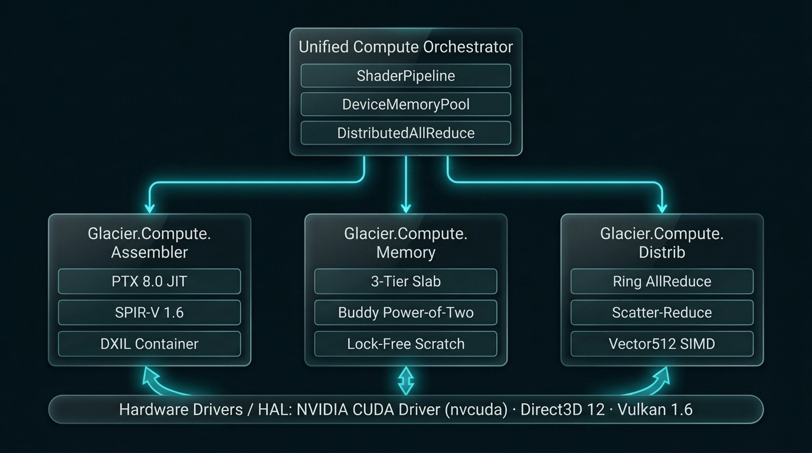

# Glacier.Compute Architecture

<p align="center">
  
</p>

## 1. Design Constraints

1. **Zero Package Dependencies:** `Glacier.Compute` targets `.NET 10` (`<IsAotCompatible>true</IsAotCompatible>`, `<TreatWarningsAsErrors>true</TreatWarningsAsErrors>`) without third-party runtime packages.
2. **Honest Backend Boundaries:** PTX 8.0 text and SPIR-V 1.6 binary compute modules are generated in memory without external tools. Direct IR-to-DXIL generation is blocked behind `NotSupportedException` because retail Direct3D 12 drivers enforce cryptographic `dxil.dll` validation; `DxbcContainerBuilder` instead packages precompiled DXC LLVM 3.7 bitcode payloads.
3. **Host Metadata Only on External Arenas:** All four allocators store bitmasks, order lists, and ring cursors in host memory and never dereference arena addresses from C#, allowing the same allocator code to manage CUDA VRAM pointers, HIP/Vulkan device allocations, pinned host buffers, or unmanaged host heaps.

---

## 2. Shader Pipeline & Bytecode Emitters (`Glacier.Compute.Assembler`)

### 2.1 Intermediate Representation & Cache Lookup

`Instruction` packs `(Opcode, OperandA, OperandB, Destination)` into 16 bytes over 64 virtual `float` registers (`f0..f63`) and 64 virtual `uint` registers (`r0..r63`). `ShaderPipeline` hashes `(ShaderStage, flagsMask, instructions)` and looks up cached `ComputeKernel` objects via `Dictionary<KernelCacheKey, ...>.GetAlternateLookup<KernelLookupKey>()` before releasing the lock during compilation.

### 2.2 NVIDIA PTX 8.0 (`PtxEmitter`, `PtxKernelBuilder`, `CudaDriver`)

- Emits `.version 8.0` kernels targeting `sm_90` by default (configurable via `targetArch`) with four kernel parameters (`param_input_a`, `param_input_b`, `param_output`, `param_n`) and 4 KB of `.shared` scratch (`smem_workspace[4096]`).
- `CuDriver` loads `nvcuda.dll` or `libcuda.so.1` lazily through `NativeLibrary.TryLoad` and stores native entry points as `delegate* unmanaged` pointers, using stack-allocated UTF-8 buffers (`stackalloc byte[...]`) for zero heap allocation on `cuModuleLoadDataEx` and `cuModuleGetFunction`.

### 2.3 Khronos SPIR-V 1.6 (`SpirvBinaryEmitter`, `SpirvValidator`)

1. **Header:** Magic `0x07230203`, Version `0x00010600` (1.6), Generator `0x00130000`, `Bound`, Schema `0`.
2. **Capabilities & Extensions:** Declares `CapabilityShader`; adds `CapabilityGroupNonUniformShuffle` (`65`) when `ShflSyncBfly` is present, and `CapabilityAtomicFloat32AddEXT` (`6033`) + `"SPV_EXT_shader_atomic_float_add"` when `AtomicAdd` is present.
3. **Math Intrinsics:** Imports `GLSL.std.450` to emit `Fma` (`50`), `FAbs` (`4`), `FMin` (`37`), `FMax` (`40`), `Sqrt` (`31`), `InverseSqrt` (`32`), `Exp` (`27`), `Log` (`28`), and `Tanh` (`21`).
4. **Descriptor Layout (`ShaderStage.Compute`):**
   - `set = 0, binding = 0..2`: `StorageBuffer` (`input_a`, `input_b`, `output` as `float[]` with `ArrayStride = 4`).
   - `PushConstant`: `{ uint param_n; }` at offset `0`.
   - `Input` built-ins: `BuiltInGlobalInvocationId` and `BuiltInLocalInvocationId` (rejected for non-compute stages).
   - `Workgroup` shared array: `float[1024]` emitted on demand for `LoadShared` / `StoreShared`.
5. **Single-Block & ID Invariants:** `SpirvValidator.Validate` checks header framing, `0 < id < bound` across operands, and single `OpReturn` block termination before `OpFunctionEnd`.

### 2.4 DXBC Packager (`DxbcContainerBuilder`, `DxbcContainerReader`)

`DxbcContainerBuilder.PackagePrecompiledShader` wraps precompiled DXC LLVM 3.7 bitcode (`0xDEC04342` / `0x0B17C0DE`) in a 16-byte `DXIL` header chunk plus a `PSV0` pipeline state validation chunk, writing container bytes with an MD5 structural digest at bytes `[4..19]`. `DxbcContainerReader.Parse` validates chunk bounds without trusting unverified lengths.

---

## 3. Multi-Tier Memory Architecture (`Glacier.Compute.Memory`)

```text
DeviceMemoryPool
├── SlabAllocator          (256 B .. 64 KB, 9 power-of-two bins, 64-bit CAS bitmasks)
├── BuddyAllocator         (128 KB .. 32 MB, 9 binary orders, XOR buddy coalescing)
├── VirtualMemoryReservoir (VirtualAlloc MEM_RESERVE / mmap PROT_NONE, page-level commit)
└── RingScratchWorkspace   (64 B aligned lock-free CAS circular ring with wrap padding)
```

When constructed from an external arena `(baseAddress, byteLength, releaseAction)`, `DeviceMemoryPool` partitions the range into 64 KB-aligned disjoint sub-arenas (~12.5% `SlabTier`, ~12.5% `ScratchTier`, ~50% `BuddyTier`, and ~25% `VirtualTier`) and invokes `releaseAction(baseAddress)` once on disposal.

In standalone host mode:
- `SlabAllocator` allocates each `SlabBin` lazily upon first request for that size bin.
- `BuddyAllocator` allocates a single 4 KB-aligned host arena and maintains host-side free lists.
- `VirtualMemoryReservoir` reserves address space with `MEM_RESERVE | PAGE_NOACCESS` (Windows) or `mmap(PROT_NONE, MAP_PRIVATE | MAP_ANONYMOUS)` (Linux `0x20` / macOS `0x1000`), commits pages only on `Allocate` (`MEM_COMMIT` / `mprotect(PROT_READ | PROT_WRITE)`), and releases physical pages on `Free` (`MEM_DECOMMIT` / `madvise(MADV_DONTNEED)` + `mprotect(PROT_NONE)`).
- `RingScratchWorkspace` updates slot turns and ring offsets atomically via `Interlocked.CompareExchange` so concurrent threads cannot claim overlapping wrap spans.

---

## 4. Distributed Ring AllReduce (`Glacier.Compute.Distrib`)

`DistributedContext` partitions an $M$-element `Memory<float>` buffer across $N$ ranks (`baseChunk = M / N`, first `M % N` ranks take `+1` element). Each reduction executes $N - 1$ concurrent send/receive steps combining incoming slices with `SimdAccumulator` (`Vector512<float>`, `Vector256<float>`, `Vector128<float>`, scalar tail), followed by $N - 1$ all-gather broadcast steps over either `InMemoryRingTransport` channels or `RingSocketTransport` TCP framing.
